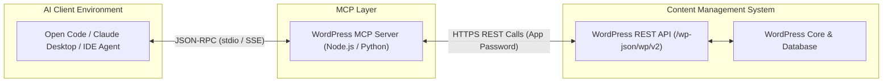

# 🌐 WordPress & Model Context Protocol (MCP) Integration

> A graduation capstone project demonstrating real-time bidirectional integration between autonomous AI coding assistants (Open Code, Claude Desktop, Antigravity) and the WordPress CMS using the Model Context Protocol (MCP).

[-blueviolet?style=for-the-badge&logo=anthropic&logoColor=white)](https://modelcontextprotocol.io/)
[](https://wordpress.org/)
[](https://developer.wordpress.org/rest-api/)
[](https://nodejs.org/)
[](https://github.com/kersonik/rocnikovy-projekt)
[](license.txt)

---

## 📌 Project Overview

Traditional CMS workflows require human editors or rigid batch scripts to draft, publish, format, and audit content. 

This graduation capstone project (*Ročníkový projekt*) establishes an autonomous bridge between modern Large Language Model (LLM) coding agents and WordPress by deploying a dedicated **Model Context Protocol (MCP)** server. Through this protocol, AI environments can query, generate, update, and manage WordPress posts, taxonomies, and site metadata in real time via standardized tool calls.

The repository encapsulates both the configured WordPress CMS instance and the accompanying educational knowledge base (*Open Code & WordPress MCP Návod*) hosted at `kersonik.app`.

---

## 🏗️ System Architecture



### Execution Flow:
1. **Tool Invocation**: The AI agent decides it needs to fetch or publish an article and executes a standardized MCP tool (e.g. `create_wp_post`).
2. **Protocol Translation**: The MCP server translates the incoming JSON-RPC tool parameters into authenticated WordPress REST API HTTP requests.
3. **Execution & Response**: WordPress validates the Application Password, executes the request against MySQL, and returns the JSON payload back to the agent.

---

## 📚 Educational Course Curriculum (`kersonik.app`)

The documentation portal hosted within this instance structures the learning pathway into 6 practical chapters:

1. **[Základní pojmy](wp-content/cache/wpo-cache/kersonik.app/opencode-wordpress-navod/1-zakladni-pojmy/)**: Introduction to LLM agents, tool calling, REST APIs, and what the Model Context Protocol solves.
2. **[Co je k tomu potřeba](wp-content/cache/wpo-cache/kersonik.app/opencode-wordpress-navod/2-co-je-k-tomu-potreba/)**: System prerequisites, Node.js runtime, WordPress Application Passwords, and environment preparation.
3. **[Instalace WordPress MCP](wp-content/cache/wpo-cache/kersonik.app/opencode-wordpress-navod/3-instalace-wordpress-mcp/)**: Cloning, building, and configuring the MCP translation server.
4. **[Konfigurace Open Code](wp-content/cache/wpo-cache/kersonik.app/opencode-wordpress-navod/4-konfigurace-opencode/)**: Registering MCP endpoints in agent configuration files (`claude_desktop_config.json` / Open Code settings).
5. **[Co když to nejde](wp-content/cache/wpo-cache/kersonik.app/opencode-wordpress-navod/5-co-kdyz-to-nejde/)**: Comprehensive troubleshooting guide for CORS headers, HTTP 401 errors, and REST route permissions.
6. **[K čemu to je dobré & Výhody a nevýhody](wp-content/cache/wpo-cache/kersonik.app/opencode-wordpress-navod/6-k-cemu-to-je-dobre/)**: Practical real-world applications, security caveats, content auditing, and future outlook.

---

## 🛠️ Prerequisites & System Requirements

- **Supported Operating Systems**:
  - Arch Linux
  - Ubuntu / Debian (22.04 LTS+)
  - Windows 10 / Windows 11
- **Server Runtime**: PHP 7.4+ or 8.x, MySQL / MariaDB, Web Server (Apache, Nginx, or LiteSpeed).
- **Client Tools**: Node.js (v18.x+) or Python 3.10+.
- **Authentication**: WordPress user account with an active **Application Password**.

---

## 🚀 Setup & Configuration

### 1. Configure WordPress Application Password
1. Navigate to **WordPress Admin > Users > Profile**.
2. Scroll to the **Application Passwords** section.
3. Provide an application label (e.g. `OpenCode-MCP`) and click **Add New Application Password**.
4. Securely copy the generated 24-character key.

---

### 2. Configure MCP Server

#### Linux (Arch Linux / Ubuntu / Debian)

```bash
# Clone the repository
git clone git@github.com:kersonik/rocnikovy-projekt.git
cd rocnikovy-projekt

# Set up environment variables
export WP_URL="https://your-wordpress-site.com"
export WP_USER="your_admin_username"
export WP_APP_PASS="xxxx xxxx xxxx xxxx xxxx"

# Start the MCP server
npm install
npm start
```

#### Windows 10 / 11 (PowerShell)

```powershell
# Set environment variables
$env:WP_URL="https://your-wordpress-site.com"
$env:WP_USER="your_admin_username"
$env:WP_APP_PASS="xxxx xxxx xxxx xxxx xxxx"

# Launch MCP server
npm install
npm start
```

---

### 3. Connect to AI Client (e.g. Claude Desktop / Open Code)

Add the MCP server entry into your agent's configuration file (e.g. `claude_desktop_config.json`):

```json
{
  "mcpServers": {
    "wordpress": {
      "command": "node",
      "args": ["/path/to/rocnikovy-projekt/mcp-server/index.js"],
      "env": {
        "WP_URL": "https://your-wordpress-site.com",
        "WP_USER": "your_username",
        "WP_APP_PASS": "your_application_password"
      }
    }
  }
}
```

Once connected, your AI assistant will gain direct access to WordPress management tools:
- `get_wp_posts`: Search and retrieve existing articles and pages.
- `create_wp_post`: Draft and publish new content with Markdown or HTML formatting.
- `update_wp_post`: Edit titles, categories, tags, or content of published posts.
- `delete_wp_post`: Trash or permanently remove obsolete entries.

---

## 🔒 Security Best Practices

1. **Least-Privilege Accounts**: Create a dedicated WordPress editor account rather than using full administrator credentials for automated MCP integration.
2. **Encrypted Credentials**: Never commit plaintext Application Passwords into source control; use environment variables or secret managers.
3. **HTTPS Enforcement**: Ensure the target WordPress installation enforces SSL/TLS to protect authentication headers during REST API transmissions.

---

## 📄 License

The WordPress core and associated components are licensed under the [GNU General Public License v2 or later](license.txt).
