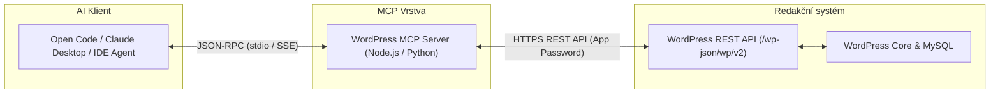

# Integrace WordPressu a Model Context Protocol (MCP)

Ročníkový projekt zaměřený na obousměrné propojení AI asistentů (Open Code, Claude Desktop, Antigravity) s redakčním systémem WordPress pomocí protokolu Model Context Protocol (MCP).

Projekt obsahuje konfiguraci pro WordPress a dokumentační kurz (*Open Code & WordPress MCP Návod*), který podrobně vysvětluje integraci, správu obsahu a volání nástrojů přes REST API.

## Architektura řešení



### Princip fungování:
1. **Volání nástroje:** AI agent vyvolá MCP nástroj (např. `create_wp_post`).
2. **Překlad protokolu:** MCP server převede JSON-RPC požadavek na volání WordPress REST API.
3. **Zpracování požadavku:** WordPress ověří přístup přes aplikační heslo (Application Password), provede operaci v databázi a vrátí výsledek zpět agentovi.

## Obsah kurzu (kersonik.app)

V rámci projektu je zpracován návod rozdělený do 6 kapitol:

1. **Základní pojmy:** Představení LLM agentů, tool calling, REST API a role protokolu Model Context Protocol.
2. **Co je k tomu potřeba:** Požadavky na prostředí, Node.js, aplikační hesla ve WordPressu.
3. **Instalace WordPress MCP:** Klonování, sestavení a nastavení MCP serveru.
4. **Konfigurace Open Code:** Registrace MCP endpointů v konfiguračních souborech klienta (`claude_desktop_config.json` nebo nastavení Open Code).
5. **Řešení potíží:** Běžné chyby (CORS hlavičky, HTTP 401, oprávnění REST endpointů).
6. **Využití v praxi:** Možnosti automatizace, bezpečnostní aspekty a audit obsahu.

## Požadavky

- **Operační systém:** Linux (Arch, Ubuntu/Debian), Windows 10/11 nebo macOS
- **Server:** PHP 7.4+ nebo 8.x, MySQL / MariaDB, webový server (Apache / Nginx / LiteSpeed)
- **Klientské prostředí:** Node.js 18+ nebo Python 3.10+
- **Autentizace:** Uživatelský účet WordPress s vygenerovaným aplikačním heslem (**Application Password**)

## Nastavení a spuštění

### 1. Vygenerování aplikačního hesla ve WordPressu

1. V administraci WordPressu přejděte do **Uživatelé > Profil**.
2. Sjeďte k sekci **Aplikační hesla** (Application Passwords).
3. Zadejte název (např. `OpenCode-MCP`) a klikněte na **Přidat nové aplikační heslo**.
4. Vygenerovaný klíč si bezpečně uložte.

### 2. Spuštění MCP serveru

#### Linux / macOS

```bash
git clone git@github.com:kersonik/rocnikovy-projekt.git
cd rocnikovy-projekt

export WP_URL="https://vase-domena.cz"
export WP_USER="uzivatelske_jmeno"
export WP_APP_PASS="xxxx xxxx xxxx xxxx xxxx"

npm install
npm start
```

#### Windows (PowerShell)

```powershell
$env:WP_URL="https://vase-domena.cz"
$env:WP_USER="uzivatelske_jmeno"
$env:WP_APP_PASS="xxxx xxxx xxxx xxxx xxxx"

npm install
npm start
```

### 3. Konfigurace v AI klientovi

Ukázka konfigurace pro Claude Desktop (`claude_desktop_config.json`):

```json
{
  "mcpServers": {
    "wordpress": {
      "command": "node",
      "args": ["/cesta/k/rocnikovy-projekt/mcp-server/index.js"],
      "env": {
        "WP_URL": "https://vase-domena.cz",
        "WP_USER": "uzivatelske_jmeno",
        "WP_APP_PASS": "aplikacni_heslo"
      }
    }
  }
}
```

Dostupné nástroje pro asistenta:
- `get_wp_posts`: Vyhledání a načtení existujících příspěvků a stránek.
- `create_wp_post`: Publikování nového článku (Markdown nebo HTML).
- `update_wp_post`: Úprava nadpisů, rubrik, štítků a obsahu.
- `delete_wp_post`: Přesunutí příspěvku do koše nebo jeho trvalé smazání.

## Bezpečnostní doporučení

- **Vyhrazený uživatelský účet:** Pro automatické napojení používejte účet s minimálními potřebnými právy (např. role Redaktor / Editor), nikoli administrátora.
- **Zabezpečení přihlašovacích údajů:** Neukládejte hesla v otevřeném textu do gitu; využijte proměnné prostředí.
- **Šifrované spojení:** WordPress musí komunikovat přes HTTPS, aby nedocházelo k odposlechu autentizačních hlaviček.

## Licence

WordPress a související části podléhají licenci [GNU GPL v2+](license.txt).
